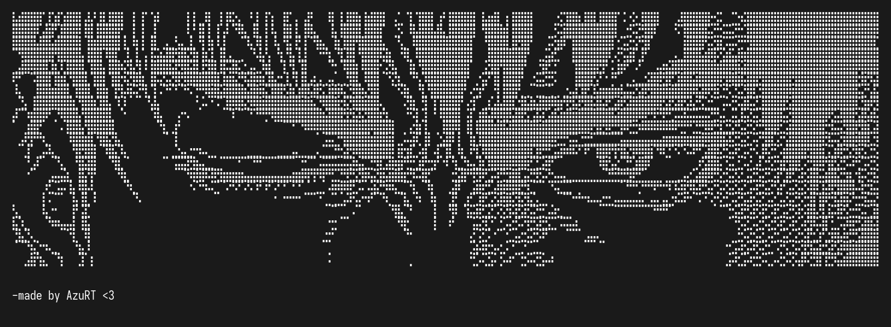

# Guts Terminal

Un bandeau des yeux de Guts pour le terminal, dessiné avec de petits caractères Unicode blancs.



-made by AzuRT <3

## Installation

Python 3 et un terminal compatible Unicode sont requis. Aucun paquet Python supplémentaire n'est nécessaire.

```sh
git clone https://github.com/guestop89/guts-terminal.git
cd guts-terminal
sh install.sh
guts-banner
```

Le dessin occupe jusqu'à 144 colonnes et 21 lignes par défaut, et s'adapte automatiquement à la fenêtre. Le crédit apparaît deux lignes sous le dessin.

```sh
guts-banner --width 180
guts-banner --plain
```

La largeur peut aller de 24 à 200 colonnes.

## Au démarrage de Fish

Ajouter à `~/.config/fish/config.fish`, après les autres configurations du shell :

```fish
function fish_greeting
    if test -t 1; and test "$TERM" != dumb; and test -x "$HOME/.local/bin/guts-banner"
        "$HOME/.local/bin/guts-banner"
    end
end
```

## Bash / Zsh

Ajouter dans `~/.bashrc` ou `~/.zshrc` :

```sh
if [[ $- == *i* ]] && [[ -t 1 ]] && [[ $TERM != dumb ]]; then
    "$HOME/.local/bin/guts-banner"
fi
```

## Kitty

Pour une grande fenêtre au lancement, options facultatives dans `~/.config/kitty/kitty.conf` :

```conf
remember_window_size no
initial_window_width 148c
initial_window_height 36c
```

## Illustration

Fan art de Berserk. Le crédit concerne l'adaptation pour le terminal. Le personnage et l'illustration d'origine appartiennent à leurs ayants droit.

[Image de référence](https://i.etsystatic.com/58313285/r/il/c8beee/6811251691/il_fullxfull.6811251691_43ka.jpg)
